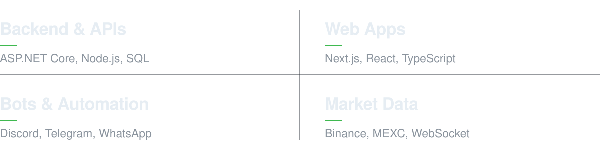

  
  
  
  

 

## About

I'm a software developer at **SekomPOS** in Istanbul. I build **.NET back-ends and APIs**, **Next.js / React web apps**, and **bots and automation tools** that take repetitive work off people's hands.

Since 2023 I've shipped 60+ projects. They include ASP.NET Core APIs with JWT auth, real-time crypto market trackers built on WebSocket streams, Discord, Telegram and WhatsApp bots, and full FiveM roleplay server systems.

- **Now:** building automation platforms with Next.js, TypeScript and Node.js
- **Interested in:** clean API design, real-time data, developer tooling
- **Open to:** freelance work, collaboration and interesting automation problems

 

 

## What I Do

 

## Tech Stack

<table>
  <tr>
    <td width="150"><b>Languages</b></td>
    <td></td>
  </tr>
  <tr>
    <td><b>Back-end</b></td>
    <td></td>
  </tr>
  <tr>
    <td><b>Front-end</b></td>
    <td></td>
  </tr>
  <tr>
    <td><b>Automation</b></td>
    <td>
      
       
      
      
      
      
      
    </td>
  </tr>
  <tr>
    <td><b>Tools</b></td>
    <td></td>
  </tr>
</table>

 

## Featured Work

| Project | Description | Stack |
|---|---|---|
| [**EB_DiscordTicketBot**](https://github.com/EfeBASARAN/EB_DiscordTicketBot) | Ticket and support system for Discord servers | `JavaScript` `discord.js` |
| [**TelegramBot**](https://github.com/EfeBASARAN/TelegramBot) | Telegram automation with a Next.js control panel | `TypeScript` `Next.js` `GramJS` `Zustand` |
| [**FivemFullServer**](https://github.com/EfeBASARAN/FivemFullServer) | Complete FiveM roleplay server setup | `Lua` |
| [**EB_CursorFix**](https://github.com/EfeBASARAN/EB_CursorFix) | Lightweight Windows utility that fixes cursor issues | `C#` `.NET` |

<b>Private and client work</b>

 

| Area | What I built | Stack |
|---|---|---|
| **Crypto & market data** | Volume and price-change trackers, signal alerts, Binance / MEXC futures tools | `C#` `Python` `WebSocket` `Binance API` |
| **Messaging automation** | Telegram content forwarding, scheduled messaging, WhatsApp automation | `TypeScript` `Python` `mtcute` `Baileys` |
| **Web platforms** | Crypto news and data site, SMS-verification platform, admin dashboards | `Next.js` `Prisma` `Tailwind` `Recharts` |
| **Enterprise .NET** | E-logbook system, banking API with JWT, parking payment MVC, API health monitoring | `ASP.NET Core` `MVC` `NLog` `SQL` |
| **Game servers** | FiveM management and police Discord bots with MySQL | `discord.js` `MySQL` `Python` |

 

