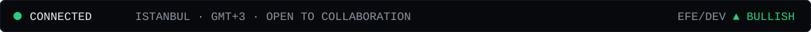

  <b>Open source:</b>&nbsp;
  <a href="https://github.com/EfeBASARAN/EB_DiscordTicketBot">EB_DiscordTicketBot</a> ·
  <a href="https://github.com/EfeBASARAN/TelegramBot">TelegramBot</a> ·
  <a href="https://github.com/EfeBASARAN/FivemFullServer">FivemFullServer</a> ·
  <a href="https://github.com/EfeBASARAN/EB_CursorFix">EB_CursorFix</a>

  
  

