 

  <b>Open source</b> &nbsp;·&nbsp;
  <a href="https://github.com/EfeBASARAN/TelegramBot">TelegramBot</a> &nbsp;·&nbsp;
  <a href="https://github.com/EfeBASARAN/EB_DiscordTicketBot">EB_DiscordTicketBot</a> &nbsp;·&nbsp;
  <a href="https://github.com/EfeBASARAN/EB_CursorFix">EB_CursorFix</a> &nbsp;·&nbsp;
  <a href="https://github.com/EfeBASARAN/FivemFullServer">FivemFullServer</a>

 

  

  
  

